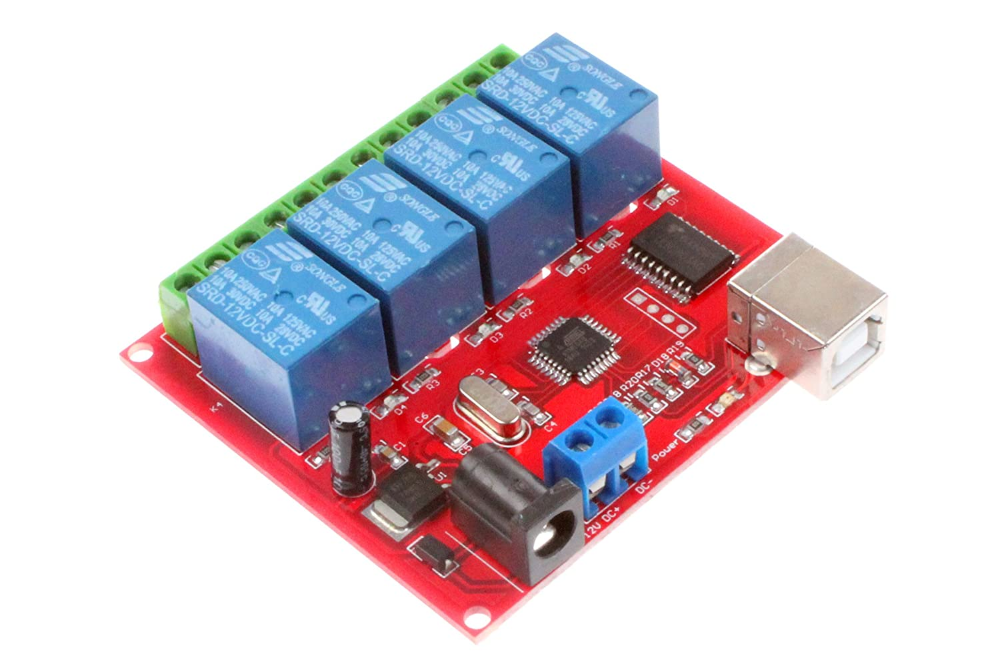
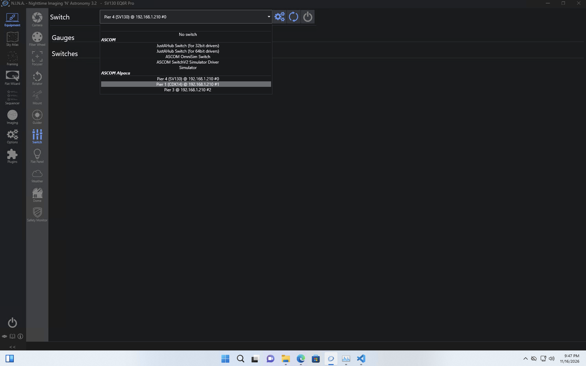
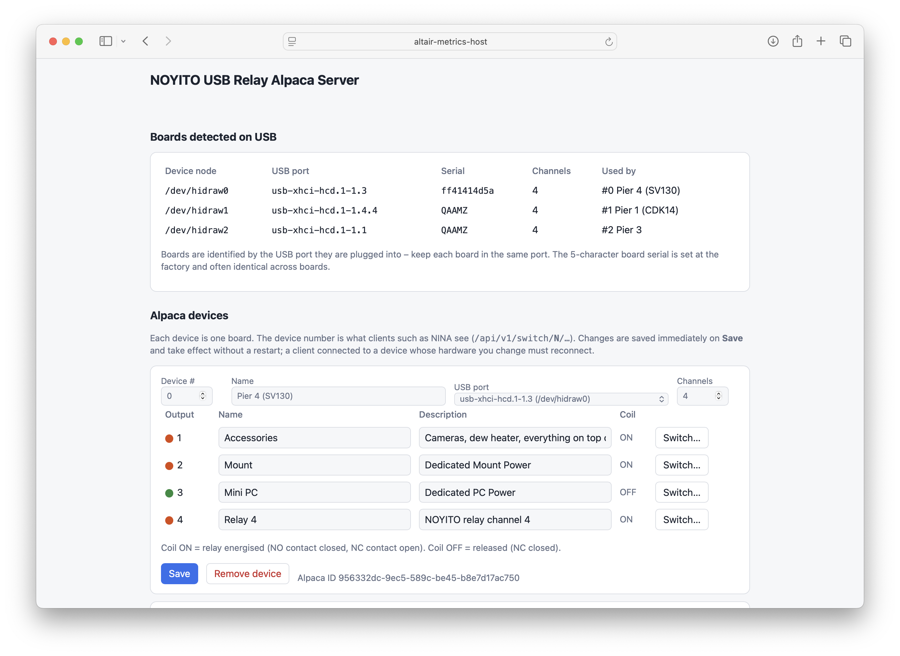

# NOYITO USB Relay – ASCOM Alpaca server

Linux/Raspberry Pi Alpaca **Switch** driver for NOYITO / DCTTech HID USB relay boards (USB 16c0:05df, "USBRelay4").
One server exposes **N boards** as N Alpaca Switch devices (device numbers 0..N-1, in `config.toml` order).



- Talks to the boards natively through `/dev/hidraw*` (HID feature reports) – no libhidapi, no UsbRelayNet.
- Falcon-based Alpaca API (interface v3), management API, UDP discovery, and a `/setup` page for channel names.
- Channel names/descriptions set by clients (e.g. NINA) are saved in `state.json`.

> **Looking for a Windows driver?** For the traditional (COM-based) ASCOM Switch driver for these boards, see
> [ascom.noyito.switch](https://bitbucket.org/cesvensson/ascom.noyito.switch/src/main/). This project is the
> Linux/Raspberry Pi Alpaca alternative, usable from any Alpaca client over the network.

## Install

```bash
python3 -m venv .venv && .venv/bin/pip install -r requirements.txt
sudo cp udev/99-noyito-relay.rules /etc/udev/rules.d/ && sudo udevadm control --reload && sudo udevadm trigger
# (you must be in the plugdev group; re-plug the boards or log in again)
.venv/bin/python -m noyito_alpaca --list      # read-only: shows serial / usb_path of each board
```

Start the server and open **`http://<pi>:11111/setup`** to configure everything in the browser (see below).
Alternatively seed the first run from `config.toml`: one `[[device]]` per board, identified by `usb_path`
(unique per physical port; the factory `serial` is often identical across boards). Then:

```bash
.venv/bin/python -m noyito_alpaca -c config.toml
# as a service:
sudo cp systemd/noyito-alpaca.service /etc/systemd/system/ && sudo systemctl enable --now noyito-alpaca
```

Open `http://<pi>:11111/setup`. In NINA / other Alpaca clients the server appears via discovery
(or add `<pi>:11111` manually).



## Configuration web page (`/setup`)



- Lists the boards detected on USB and which Alpaca device (if any) each one belongs to; **Add as device** creates one.
- Edit per device: Alpaca device number, name, USB port, channel count, and **name / description of every output**
  (these are what NINA etc. show). Changes apply immediately, no restart.
- Live coil state per output; a **Switch…** button (with a confirmation) energises/releases a relay so you can
  work out which output is which. Coil ON = relay energised (NO closed, NC open).
- Stored in `devices.json` (devices) and `state.json` (output names). `config.toml` `[[device]]` blocks only seed
  `devices.json` the first time; after that the web page owns the list.
- There is no authentication, like most Alpaca servers: only run it on a trusted network.

## Notes

- Each channel is a boolean switch (min 0, max 1, step 1). Async switch methods are not supported (`CanAsync` = false).
- Boards are addressed by USB port, so keep each board in the same port.
- `mock = true` on a `[[device]]` gives an in-memory board for testing / ConformU without hardware.
- ConformU: passes Alpaca protocol + conformance on mock and real boards – see `conformu/`.
- Tests: `.venv/bin/pip install pytest && .venv/bin/python -m pytest tests`
- Relay state is read from the board on every request, so changes made elsewhere are always reflected.
